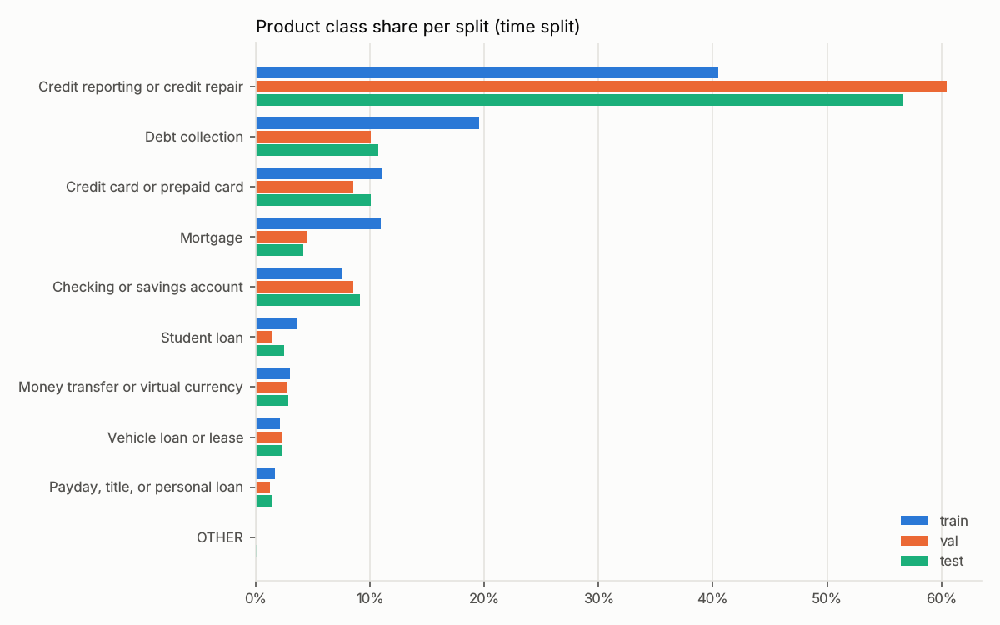
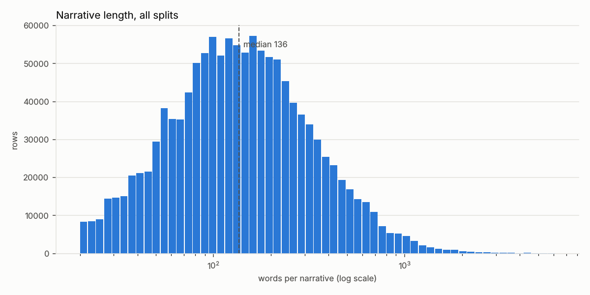
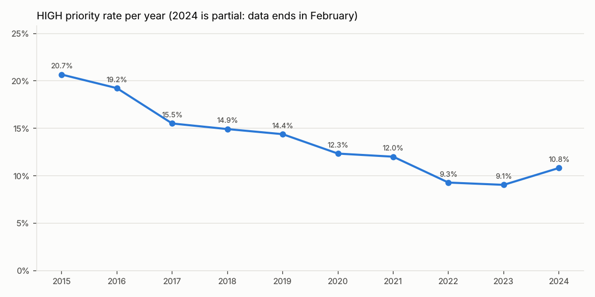
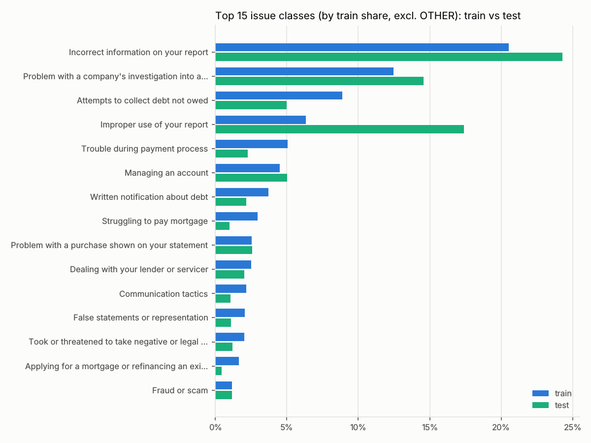

# M2 data statistics

Generated by `make data` (`python -m complaintiq.data.pipeline build`). Aggregates only; no complaint text. Source: Hugging Face mirror of the CFPB database (see docs/data_provenance.md).

## 1. Cleaning funnel

| step | rows |
|---|---|
| non-empty narrative | 1,689,593 |
| after excluding products: Consumer Loan | 1,680,132 |
| after min_words >= 20 | 1,609,093 |
| after duplicate Complaint ID drop | 1,609,093 |
| after duplicate normalized-narrative drop (keep earliest) | 1,253,594 |

Duplicate normalized-narrative groups: 103,762 (459,261 rows before the drop). The hash key is the lowercased normalized text, so near-duplicates that differ by more than case, whitespace or placeholders are not caught (no MinHash).

## 2. Splits

Time split cutoffs (also in `configs/data.yaml`): train <= 2022-09-12, val <= 2023-05-05, test after. Rows of one date stay together. Assertions passed: no Complaint ID or normalized-text overlap across splits (both splits), strict date ordering (time split), no outcome columns in outputs. Secondary split: stratified random on `product_class`, seed 42.

| split | time_rows | time_first | time_last | random_rows |
|---|---|---|---|---|
| train | 877,895 | 2015-03-19 | 2022-09-12 | 877,522 |
| val | 187,698 | 2022-09-13 | 2023-05-05 | 188,039 |
| test | 188,001 | 2023-05-06 | 2024-02-09 | 188,033 |

## 3. Label distributions (time split)

### Product class

| product_class | train_n | train_share | val_n | val_share | test_n | test_share |
|---|---|---|---|---|---|---|
| Credit reporting or credit repair | 355,475 | 0.405 | 113,487 | 0.605 | 106,396 | 0.566 |
| Debt collection | 171,562 | 0.195 | 18,964 | 0.101 | 20,223 | 0.108 |
| Credit card or prepaid card | 97,133 | 0.111 | 16,090 | 0.086 | 18,989 | 0.101 |
| Mortgage | 95,851 | 0.109 | 8,488 | 0.045 | 7,847 | 0.042 |
| Checking or savings account | 65,957 | 0.075 | 16,000 | 0.085 | 17,109 | 0.091 |
| Student loan | 31,764 | 0.036 | 2,759 | 0.015 | 4,712 | 0.025 |
| Money transfer or virtual currency | 26,550 | 0.030 | 5,261 | 0.028 | 5,337 | 0.028 |
| Vehicle loan or lease | 18,719 | 0.021 | 4,264 | 0.023 | 4,393 | 0.023 |
| Payday, title, or personal loan | 14,593 | 0.017 | 2,385 | 0.013 | 2,728 | 0.015 |
| OTHER | 291 | 0.000 | 0 | 0.000 | 267 | 0.001 |

### Issue class

| issue_class | train_n | train_share | val_n | val_share | test_n | test_share |
|---|---|---|---|---|---|---|
| Incorrect information on your report | 180,269 | 0.205 | 46,150 | 0.246 | 45,650 | 0.243 |
| Problem with a company's investigation into an existing problem | 109,403 | 0.125 | 32,313 | 0.172 | 27,368 | 0.146 |
| Attempts to collect debt not owed | 77,961 | 0.089 | 9,218 | 0.049 | 9,392 | 0.050 |
| OTHER | 65,874 | 0.075 | 9,415 | 0.050 | 10,106 | 0.054 |
| Improper use of your report | 55,489 | 0.063 | 33,299 | 0.177 | 32,699 | 0.174 |
| Trouble during payment process | 44,415 | 0.051 | 4,308 | 0.023 | 4,286 | 0.023 |
| Managing an account | 39,509 | 0.045 | 9,142 | 0.049 | 9,446 | 0.050 |
| Written notification about debt | 32,552 | 0.037 | 3,317 | 0.018 | 4,090 | 0.022 |
| Struggling to pay mortgage | 25,956 | 0.030 | 2,271 | 0.012 | 1,850 | 0.010 |
| Problem with a purchase shown on your statement | 22,454 | 0.026 | 4,256 | 0.023 | 4,836 | 0.026 |
| Dealing with your lender or servicer | 21,973 | 0.025 | 2,296 | 0.012 | 3,803 | 0.020 |
| Communication tactics | 18,869 | 0.021 | 1,641 | 0.009 | 1,987 | 0.011 |
| False statements or representation | 18,161 | 0.021 | 2,053 | 0.011 | 2,035 | 0.011 |
| Took or threatened to take negative or legal action | 17,935 | 0.020 | 2,309 | 0.012 | 2,287 | 0.012 |
| Applying for a mortgage or refinancing an existing mortgage | 14,517 | 0.017 | 964 | 0.005 | 846 | 0.004 |
| Fraud or scam | 10,128 | 0.012 | 2,423 | 0.013 | 2,182 | 0.012 |
| Other features, terms, or problems | 9,655 | 0.011 | 1,939 | 0.010 | 2,215 | 0.012 |
| Closing on a mortgage | 8,977 | 0.010 | 701 | 0.004 | 590 | 0.003 |
| Unable to get your credit report or credit score | 8,870 | 0.010 | 1,490 | 0.008 | 1,193 | 0.006 |
| Fees or interest | 8,742 | 0.010 | 1,611 | 0.009 | 1,951 | 0.010 |
| Problem when making payments | 8,461 | 0.010 | 1,571 | 0.008 | 1,645 | 0.009 |
| Struggling to repay your loan | 7,626 | 0.009 | 262 | 0.001 | 621 | 0.003 |
| Closing an account | 7,469 | 0.009 | 2,277 | 0.012 | 2,592 | 0.014 |
| Closing your account | 7,144 | 0.008 | 1,069 | 0.006 | 1,296 | 0.007 |
| Getting a credit card | 6,852 | 0.008 | 2,091 | 0.011 | 2,155 | 0.011 |
| Managing the loan or lease | 6,549 | 0.007 | 1,387 | 0.007 | 1,547 | 0.008 |
| Threatened to contact someone or share information improperly | 6,084 | 0.007 | 426 | 0.002 | 432 | 0.002 |
| Problem with a lender or other company charging your account | 6,041 | 0.007 | 2,021 | 0.011 | 2,330 | 0.012 |
| Opening an account | 5,762 | 0.007 | 1,493 | 0.008 | 1,594 | 0.008 |
| Advertising and marketing, including promotional offers | 5,576 | 0.006 | 837 | 0.004 | 967 | 0.005 |
| Problem caused by your funds being low | 5,495 | 0.006 | 988 | 0.005 | 1,083 | 0.006 |
| Trouble using your card | 5,350 | 0.006 | 1,047 | 0.006 | 1,623 | 0.009 |
| Problem with fraud alerts or security freezes | 4,914 | 0.006 | 597 | 0.003 | 764 | 0.004 |
| Unauthorized transactions or other transaction problem | 2,863 | 0.003 | 516 | 0.003 | 540 | 0.003 |

### Priority

| priority | train_n | train_share | val_n | val_share | test_n | test_share |
|---|---|---|---|---|---|---|
| NORMAL | 757,215 | 0.863 | 171,524 | 0.914 | 170,456 | 0.907 |
| HIGH | 120,680 | 0.137 | 16,174 | 0.086 | 17,545 | 0.093 |

### Random split for comparison: product class

| product_class | train_n | train_share | val_n | val_share | test_n | test_share |
|---|---|---|---|---|---|---|
| Credit reporting or credit repair | 402,751 | 0.459 | 86,304 | 0.459 | 86,303 | 0.459 |
| Debt collection | 147,525 | 0.168 | 31,612 | 0.168 | 31,612 | 0.168 |
| Credit card or prepaid card | 92,549 | 0.105 | 19,832 | 0.105 | 19,831 | 0.105 |
| Mortgage | 78,531 | 0.089 | 16,828 | 0.089 | 16,827 | 0.089 |
| Checking or savings account | 69,347 | 0.079 | 14,860 | 0.079 | 14,859 | 0.079 |
| Student loan | 27,465 | 0.031 | 5,885 | 0.031 | 5,885 | 0.031 |
| Money transfer or virtual currency | 26,004 | 0.030 | 5,572 | 0.030 | 5,572 | 0.030 |
| Vehicle loan or lease | 19,164 | 0.022 | 4,106 | 0.022 | 4,106 | 0.022 |
| Payday, title, or personal loan | 13,795 | 0.016 | 2,956 | 0.016 | 2,955 | 0.016 |
| OTHER | 391 | 0.000 | 84 | 0.000 | 83 | 0.000 |

## 4. Imbalance ratios (largest / smallest class)

Product class (excluding OTHER):

| split | classes | largest | smallest | ratio |
|---|---|---|---|---|
| test | 9 | 106,396 | 2,728 | 39.001 |
| train | 9 | 355,475 | 14,593 | 24.359 |
| val | 9 | 113,487 | 2,385 | 47.584 |

Issue class (excluding OTHER):

| split | classes | largest | smallest | ratio |
|---|---|---|---|---|
| test | 33 | 45,650 | 432 | 105.671 |
| train | 33 | 180,269 | 2,863 | 62.965 |
| val | 33 | 46,150 | 262 | 176.145 |

Priority (HIGH vs NORMAL):

| split | classes | largest | smallest | ratio |
|---|---|---|---|---|
| test | 2 | 170,456 | 17,545 | 9.715 |
| train | 2 | 757,215 | 120,680 | 6.275 |
| val | 2 | 171,524 | 16,174 | 10.605 |

## 5. Narrative length (words, after normalization)

| rows | mean | p10 | p50 | p90 | p99 | max |
|---|---|---|---|---|---|---|
| 1,253,594 | 203.571 | 45.000 | 136.000 | 421.000 | 1088.000 | 6,178 |

| split | rows | mean | p10 | p50 | p90 | p99 | max |
|---|---|---|---|---|---|---|---|
| train | 877,895 | 201.445 | 45.000 | 135.000 | 419.000 | 1068.000 | 6,178 |
| test | 188,001 | 214.207 | 45.000 | 139.000 | 441.000 | 1316.000 | 5,947 |
| val | 187,698 | 202.859 | 47.000 | 135.000 | 410.000 | 1130.000 | 5,764 |

### Per product class

| product_class | rows | mean | p10 | p50 | p90 | p99 | max |
|---|---|---|---|---|---|---|---|
| Credit reporting or credit repair | 575,358 | 177.010 | 42.000 | 115.000 | 350.000 | 1067.000 | 6,022 |
| Debt collection | 210,749 | 180.151 | 39.000 | 118.000 | 376.000 | 954.000 | 5,962 |
| Credit card or prepaid card | 132,212 | 227.443 | 55.000 | 168.000 | 458.000 | 1064.000 | 5,907 |
| Mortgage | 112,186 | 295.838 | 72.000 | 213.000 | 607.000 | 1451.000 | 5,868 |
| Checking or savings account | 99,066 | 237.481 | 53.000 | 171.000 | 489.000 | 1126.000 | 5,935 |
| Student loan | 39,235 | 232.358 | 58.000 | 172.000 | 471.000 | 1035.000 | 5,534 |
| Money transfer or virtual currency | 37,148 | 227.451 | 51.000 | 159.000 | 461.000 | 1169.000 | 5,867 |
| Vehicle loan or lease | 27,376 | 249.207 | 54.000 | 173.000 | 503.000 | 1337.000 | 6,178 |
| Payday, title, or personal loan | 19,706 | 208.036 | 48.000 | 147.000 | 422.000 | 1079.000 | 3,843 |
| OTHER | 558 | 198.996 | 39.000 | 140.000 | 425.000 | 724.000 | 1,232 |

### Per issue class

| issue_class | rows | mean | p10 | p50 | p90 | p99 | max |
|---|---|---|---|---|---|---|---|
| Incorrect information on your report | 272,069 | 168.925 | 39.000 | 112.000 | 326.000 | 1019.000 | 5,947 |
| Problem with a company's investigation into an existing problem | 169,084 | 192.343 | 47.000 | 122.000 | 389.000 | 1086.000 | 6,022 |
| Improper use of your report | 121,487 | 174.541 | 41.000 | 109.000 | 353.000 | 1028.000 | 5,806 |
| Attempts to collect debt not owed | 96,571 | 174.719 | 38.000 | 113.000 | 367.000 | 953.000 | 5,962 |
| OTHER | 85,395 | 215.690 | 50.000 | 154.000 | 439.000 | 1045.000 | 6,178 |
| Managing an account | 58,097 | 249.036 | 57.000 | 181.000 | 512.000 | 1178.000 | 5,935 |
| Trouble during payment process | 53,009 | 278.807 | 73.000 | 206.000 | 562.000 | 1290.000 | 5,517 |
| Written notification about debt | 39,959 | 179.874 | 39.000 | 119.000 | 366.000 | 877.000 | 5,436 |
| Problem with a purchase shown on your statement | 31,546 | 273.295 | 68.000 | 202.000 | 551.000 | 1289.000 | 5,768 |
| Struggling to pay mortgage | 30,077 | 318.295 | 71.000 | 227.000 | 649.000 | 1590.000 | 5,688 |
| Dealing with your lender or servicer | 28,072 | 239.944 | 62.000 | 179.000 | 481.000 | 1038.000 | 5,534 |
| Took or threatened to take negative or legal action | 22,531 | 218.480 | 47.000 | 148.000 | 452.000 | 1140.000 | 5,369 |
| Communication tactics | 22,497 | 144.648 | 35.000 | 100.000 | 298.000 | 711.000 | 3,225 |
| False statements or representation | 22,249 | 211.782 | 46.000 | 143.000 | 441.000 | 1092.000 | 5,031 |
| Applying for a mortgage or refinancing an existing mortgage | 16,327 | 301.914 | 71.000 | 219.000 | 626.000 | 1462.000 | 5,177 |
| Fraud or scam | 14,733 | 249.167 | 51.000 | 167.000 | 523.000 | 1420.000 | 4,824 |
| Other features, terms, or problems | 13,809 | 241.322 | 62.000 | 185.000 | 471.000 | 1086.000 | 5,899 |
| Closing an account | 12,338 | 230.057 | 54.000 | 165.000 | 469.000 | 1150.000 | 5,802 |
| Fees or interest | 12,304 | 219.056 | 62.000 | 171.000 | 418.000 | 910.000 | 4,412 |
| Problem when making payments | 11,677 | 218.416 | 58.000 | 159.000 | 430.000 | 1014.000 | 4,027 |
| Unable to get your credit report or credit score | 11,553 | 189.258 | 40.000 | 118.000 | 371.000 | 1343.000 | 4,370 |
| Getting a credit card | 11,098 | 169.980 | 37.000 | 116.000 | 350.000 | 887.000 | 4,261 |
| Problem with a lender or other company charging your account | 10,392 | 247.311 | 56.000 | 178.000 | 504.000 | 1228.000 | 5,301 |
| Closing on a mortgage | 10,268 | 327.565 | 77.000 | 225.000 | 661.000 | 1714.000 | 5,868 |
| Closing your account | 9,509 | 224.015 | 54.000 | 162.000 | 450.000 | 1025.000 | 5,907 |
| Managing the loan or lease | 9,483 | 245.676 | 56.000 | 177.000 | 489.000 | 1192.000 | 5,266 |
| Opening an account | 8,849 | 189.798 | 42.000 | 134.000 | 389.000 | 940.000 | 3,733 |
| Struggling to repay your loan | 8,509 | 216.846 | 52.000 | 158.000 | 443.000 | 936.000 | 4,110 |
| Trouble using your card | 8,020 | 217.622 | 57.000 | 163.000 | 425.000 | 992.000 | 4,740 |
| Problem caused by your funds being low | 7,566 | 205.318 | 46.000 | 150.000 | 426.000 | 940.000 | 3,886 |
| Advertising and marketing, including promotional offers | 7,380 | 235.936 | 67.000 | 186.000 | 447.000 | 953.000 | 4,731 |
| Threatened to contact someone or share information improperly | 6,942 | 146.568 | 37.000 | 104.000 | 304.000 | 711.000 | 2,138 |
| Problem with fraud alerts or security freezes | 6,275 | 163.229 | 40.000 | 123.000 | 320.000 | 715.000 | 2,528 |
| Unauthorized transactions or other transaction problem | 3,919 | 222.967 | 53.000 | 162.000 | 451.000 | 957.000 | 2,849 |

### Effect of the min_words = 20 cutoff per product class

Counted on narrative rows before deduplication.

| product_class | n_rows | n_dropped | share_dropped |
|---|---|---|---|
| Credit reporting or credit repair | 959,260 | 51,076 | 0.053 |
| Debt collection | 234,034 | 10,101 | 0.043 |
| Credit card or prepaid card | 143,153 | 3,044 | 0.021 |
| Mortgage | 113,466 | 1,043 | 0.009 |
| Checking or savings account | 102,137 | 2,903 | 0.028 |
| Student loan | 40,066 | 597 | 0.015 |
| Money transfer or virtual currency | 38,456 | 957 | 0.025 |
| Vehicle loan or lease | 28,555 | 698 | 0.024 |
| Payday, title, or personal loan | 20,422 | 596 | 0.029 |
| OTHER | 583 | 24 | 0.041 |

## 6. Duplicate narratives with conflicting labels (label-noise estimate)

Among duplicate-text groups (identical normalized narrative, kept the earliest row), the groups whose members carry more than one label. Raw-label conflicts include taxonomy renames; class-level conflicts are the better noise estimate.

| label | conflicting_groups | share_of_groups | rows_in_conflicting_groups |
|---|---|---|---|
| raw Product | 2,634 | 0.025 | 120,230 |
| raw Issue | 3,621 | 0.035 | 132,684 |
| product_class | 1,254 | 0.012 | 40,457 |
| issue_class | 3,262 | 0.031 | 123,584 |

### Duplicate group sizes (class-level conflicts)

| bucket | groups | rows | conflicting_product | conflicting_issue | conflicting_product_or_issue |
|---|---|---|---|---|---|
| 2 | 56,323 | 112,646 | 377 | 861 | 919 |
| 3-5 | 41,284 | 130,134 | 387 | 1,024 | 1,074 |
| 6-20 | 4,601 | 43,109 | 290 | 800 | 840 |
| >20 | 1,554 | 173,372 | 200 | 577 | 591 |
| all | 103,762 | 459,261 | 1,254 | 3,262 | 3,424 |

## 7. Temporal label drift (share per year)

### Product class

| product_class | 2015 | 2016 | 2017 | 2018 | 2019 | 2020 | 2021 | 2022 | 2023 | 2024 |
|---|---|---|---|---|---|---|---|---|---|---|
| Checking or savings account | 0.091 | 0.110 | 0.069 | 0.066 | 0.069 | 0.069 | 0.076 | 0.074 | 0.091 | 0.129 |
| Credit card or prepaid card | 0.139 | 0.140 | 0.105 | 0.111 | 0.115 | 0.124 | 0.099 | 0.088 | 0.095 | 0.142 |
| Credit reporting or credit repair | 0.182 | 0.191 | 0.339 | 0.363 | 0.400 | 0.444 | 0.448 | 0.586 | 0.579 | 0.424 |
| Debt collection | 0.277 | 0.250 | 0.213 | 0.230 | 0.205 | 0.174 | 0.189 | 0.117 | 0.106 | 0.141 |
| Money transfer or virtual currency | 0.011 | 0.010 | 0.020 | 0.030 | 0.026 | 0.034 | 0.048 | 0.033 | 0.028 | 0.023 |
| Mortgage | 0.248 | 0.225 | 0.126 | 0.098 | 0.095 | 0.093 | 0.087 | 0.051 | 0.043 | 0.081 |
| OTHER | 0.002 | 0.002 | 0.001 | 0.000 | 0.000 | 0.000 | 0.000 | 0.000 | 0.001 | 0.002 |
| Payday, title, or personal loan | 0.012 | 0.012 | 0.018 | 0.022 | 0.022 | 0.017 | 0.015 | 0.013 | 0.014 | 0.014 |
| Student loan | 0.036 | 0.060 | 0.091 | 0.050 | 0.040 | 0.018 | 0.013 | 0.018 | 0.020 | 0.008 |
| Vehicle loan or lease | 0.000 | 0.000 | 0.019 | 0.030 | 0.027 | 0.028 | 0.025 | 0.020 | 0.024 | 0.035 |

### Issue class

| issue_class | 2015 | 2016 | 2017 | 2018 | 2019 | 2020 | 2021 | 2022 | 2023 | 2024 |
|---|---|---|---|---|---|---|---|---|---|---|
| Advertising and marketing, including promotional offers | 0.006 | 0.006 | 0.007 | 0.009 | 0.009 | 0.006 | 0.005 | 0.005 | 0.005 | 0.008 |
| Applying for a mortgage or refinancing an existing mortgage | 0.036 | 0.035 | 0.017 | 0.010 | 0.011 | 0.017 | 0.017 | 0.007 | 0.005 | 0.006 |
| Attempts to collect debt not owed | 0.118 | 0.106 | 0.091 | 0.098 | 0.090 | 0.082 | 0.096 | 0.057 | 0.050 | 0.064 |
| Closing an account | 0.000 | 0.000 | 0.006 | 0.008 | 0.009 | 0.011 | 0.012 | 0.011 | 0.013 | 0.020 |
| Closing on a mortgage | 0.017 | 0.016 | 0.010 | 0.009 | 0.009 | 0.011 | 0.011 | 0.005 | 0.003 | 0.004 |
| Closing your account | 0.009 | 0.010 | 0.009 | 0.009 | 0.008 | 0.009 | 0.007 | 0.006 | 0.006 | 0.008 |
| Communication tactics | 0.044 | 0.035 | 0.026 | 0.029 | 0.025 | 0.016 | 0.015 | 0.010 | 0.010 | 0.012 |
| Dealing with your lender or servicer | 0.023 | 0.046 | 0.061 | 0.034 | 0.027 | 0.012 | 0.009 | 0.014 | 0.016 | 0.006 |
| False statements or representation | 0.027 | 0.024 | 0.022 | 0.024 | 0.023 | 0.021 | 0.019 | 0.013 | 0.011 | 0.012 |
| Fees or interest | 0.000 | 0.000 | 0.011 | 0.015 | 0.014 | 0.014 | 0.009 | 0.008 | 0.010 | 0.019 |
| Fraud or scam | 0.008 | 0.005 | 0.006 | 0.009 | 0.012 | 0.012 | 0.016 | 0.016 | 0.011 | 0.010 |
| Getting a credit card | 0.000 | 0.000 | 0.006 | 0.008 | 0.009 | 0.007 | 0.009 | 0.012 | 0.011 | 0.014 |
| Improper use of your report | 0.008 | 0.008 | 0.063 | 0.047 | 0.040 | 0.029 | 0.046 | 0.182 | 0.172 | 0.160 |
| Incorrect information on your report | 0.123 | 0.128 | 0.168 | 0.197 | 0.214 | 0.255 | 0.233 | 0.228 | 0.246 | 0.175 |
| Managing an account | 0.067 | 0.085 | 0.043 | 0.036 | 0.038 | 0.038 | 0.042 | 0.042 | 0.050 | 0.070 |
| Managing the loan or lease | 0.000 | 0.000 | 0.008 | 0.011 | 0.010 | 0.010 | 0.008 | 0.006 | 0.008 | 0.012 |
| OTHER | 0.135 | 0.135 | 0.079 | 0.070 | 0.062 | 0.068 | 0.070 | 0.050 | 0.053 | 0.059 |
| Opening an account | 0.000 | 0.000 | 0.005 | 0.007 | 0.008 | 0.007 | 0.008 | 0.008 | 0.008 | 0.012 |
| Other features, terms, or problems | 0.000 | 0.000 | 0.011 | 0.016 | 0.016 | 0.014 | 0.011 | 0.010 | 0.011 | 0.018 |
| Problem caused by your funds being low | 0.015 | 0.015 | 0.008 | 0.006 | 0.005 | 0.004 | 0.004 | 0.004 | 0.006 | 0.011 |
| Problem when making payments | 0.000 | 0.000 | 0.008 | 0.014 | 0.014 | 0.011 | 0.010 | 0.010 | 0.009 | 0.011 |
| Problem with a company's investigation into an existing problem | 0.029 | 0.036 | 0.086 | 0.112 | 0.131 | 0.150 | 0.163 | 0.169 | 0.155 | 0.090 |
| Problem with a lender or other company charging your account | 0.000 | 0.000 | 0.005 | 0.008 | 0.008 | 0.008 | 0.009 | 0.009 | 0.012 | 0.017 |
| Problem with a purchase shown on your statement | 0.019 | 0.022 | 0.020 | 0.025 | 0.028 | 0.033 | 0.027 | 0.023 | 0.024 | 0.038 |
| Problem with fraud alerts or security freezes | 0.000 | 0.000 | 0.011 | 0.006 | 0.009 | 0.007 | 0.004 | 0.003 | 0.004 | 0.006 |
| Struggling to pay mortgage | 0.087 | 0.072 | 0.042 | 0.030 | 0.023 | 0.017 | 0.016 | 0.012 | 0.011 | 0.019 |
| Struggling to repay your loan | 0.012 | 0.012 | 0.027 | 0.012 | 0.009 | 0.003 | 0.002 | 0.002 | 0.003 | 0.002 |
| Threatened to contact someone or share information improperly | 0.021 | 0.018 | 0.009 | 0.007 | 0.007 | 0.004 | 0.004 | 0.002 | 0.002 | 0.001 |
| Took or threatened to take negative or legal action | 0.023 | 0.019 | 0.024 | 0.027 | 0.024 | 0.019 | 0.019 | 0.013 | 0.012 | 0.012 |
| Trouble during payment process | 0.108 | 0.102 | 0.055 | 0.046 | 0.049 | 0.044 | 0.040 | 0.026 | 0.023 | 0.047 |
| Trouble using your card | 0.000 | 0.000 | 0.004 | 0.006 | 0.007 | 0.010 | 0.008 | 0.006 | 0.007 | 0.009 |
| Unable to get your credit report or credit score | 0.015 | 0.013 | 0.011 | 0.009 | 0.011 | 0.011 | 0.009 | 0.006 | 0.008 | 0.008 |
| Unauthorized transactions or other transaction problem | 0.005 | 0.003 | 0.002 | 0.002 | 0.003 | 0.004 | 0.005 | 0.003 | 0.003 | 0.001 |
| Written notification about debt | 0.045 | 0.049 | 0.041 | 0.044 | 0.037 | 0.033 | 0.037 | 0.023 | 0.020 | 0.039 |

## 8. Priority stability

HIGH rate and the share of rows firing each B5 rule (rules overlap, so rule shares do not sum to the HIGH rate).

### Per split (time)

| split | rows | high_rate | severity_rule | monetary_rule | untimely_rule |
|---|---|---|---|---|---|
| test | 188,001 | 0.093 | 0.044 | 0.042 | 0.010 |
| train | 877,895 | 0.137 | 0.072 | 0.052 | 0.021 |
| val | 187,698 | 0.086 | 0.042 | 0.038 | 0.009 |
| all | 1,253,594 | 0.123 | 0.063 | 0.048 | 0.018 |

### Per year

| year | rows | high_rate | severity_rule | monetary_rule | untimely_rule |
|---|---|---|---|---|---|
| 2015 | 48,862 | 0.207 | 0.114 | 0.076 | 0.035 |
| 2016 | 69,298 | 0.192 | 0.093 | 0.077 | 0.039 |
| 2017 | 103,514 | 0.155 | 0.080 | 0.053 | 0.030 |
| 2018 | 104,319 | 0.149 | 0.081 | 0.054 | 0.022 |
| 2019 | 104,918 | 0.144 | 0.080 | 0.052 | 0.019 |
| 2020 | 131,948 | 0.123 | 0.062 | 0.050 | 0.017 |
| 2021 | 159,953 | 0.120 | 0.062 | 0.046 | 0.018 |
| 2022 | 236,808 | 0.093 | 0.048 | 0.039 | 0.011 |
| 2023 | 287,945 | 0.091 | 0.043 | 0.040 | 0.010 |
| 2024 | 6,029 | 0.108 | 0.043 | 0.063 | 0.005 |
| all | 1,253,594 | 0.123 | 0.063 | 0.048 | 0.018 |

### Rule components per split (mutually exclusive; sums to the HIGH rate)

| split | rows | severity_only | monetary_only | untimely_only | overlap_2plus | high_rate |
|---|---|---|---|---|---|---|
| test | 188,001 | 0.042 | 0.040 | 0.009 | 0.003 | 0.093 |
| train | 877,895 | 0.065 | 0.048 | 0.017 | 0.008 | 0.137 |
| val | 187,698 | 0.040 | 0.036 | 0.007 | 0.003 | 0.086 |
| all | 1,253,594 | 0.058 | 0.045 | 0.014 | 0.006 | 0.123 |

### Rule components per year

| year | rows | severity_only | monetary_only | untimely_only | overlap_2plus | high_rate |
|---|---|---|---|---|---|---|
| 2015 | 48,862 | 0.096 | 0.068 | 0.025 | 0.018 | 0.207 |
| 2016 | 69,298 | 0.079 | 0.070 | 0.028 | 0.016 | 0.192 |
| 2017 | 103,514 | 0.073 | 0.050 | 0.024 | 0.009 | 0.155 |
| 2018 | 104,319 | 0.074 | 0.051 | 0.016 | 0.008 | 0.149 |
| 2019 | 104,918 | 0.073 | 0.049 | 0.015 | 0.007 | 0.144 |
| 2020 | 131,948 | 0.057 | 0.047 | 0.014 | 0.005 | 0.123 |
| 2021 | 159,953 | 0.057 | 0.043 | 0.014 | 0.006 | 0.120 |
| 2022 | 236,808 | 0.044 | 0.036 | 0.009 | 0.004 | 0.093 |
| 2023 | 287,945 | 0.041 | 0.039 | 0.008 | 0.003 | 0.091 |
| 2024 | 6,029 | 0.040 | 0.061 | 0.004 | 0.003 | 0.108 |
| all | 1,253,594 | 0.058 | 0.045 | 0.014 | 0.006 | 0.123 |

**Limitation: base-rate shift.** HIGH is 13.7% in train vs 8.6% in val vs 9.3% in test. Rules 2 and 3 are company outcomes (monetary relief, untimely response) whose rates change over time with company behaviour and CFPB processes, and rule 1 depends on issue wording that changed in 2017 and 2023. A classifier tuned on train will see a different prior at test time; thresholds should be set on validation and the shift reported with every priority metric. Priority is a proxy label, not urgency judged at intake (SPEC B5).

## 9. Residual PII (regex) leak rate

Rows with at least one hit per pattern, per 100,000 rows. `pii_card` is the raw 13-19 digit candidate; `pii_card_luhn` keeps only Luhn-valid ones; `pii_any` excludes raw card candidates. Email hits include business addresses, so rates are upper bounds.

| split | rows | rows_with_any_hit | pii_email_per_100k | pii_ssn_per_100k | pii_card_per_100k | pii_phone_per_100k | pii_long_digits_per_100k | pii_card_luhn_per_100k | pii_any_per_100k |
|---|---|---|---|---|---|---|---|---|---|
| test | 188,001 | 52 | 10.600 | 0.000 | 3.700 | 4.300 | 12.200 | 2.700 | 27.700 |
| train | 877,895 | 230 | 19.700 | 0.000 | 5.800 | 1.600 | 4.200 | 0.700 | 26.200 |
| val | 187,698 | 32 | 11.700 | 0.000 | 2.100 | 2.100 | 2.700 | 0.500 | 17.000 |
| all | 1,253,594 | 314 | 17.200 | 0.000 | 4.900 | 2.100 | 5.200 | 1.000 | 25.000 |

**Limitation:** detection is regex only. Personal names are not detected, so residual name leaks are not measured. `complaintiq.privacy.pii.scrub` is the inference-time scrubber.

## 10. Slices

`submitted_via` is kept in the outputs but is unusable as a slice:

| submitted_via | n |
|---|---|
| Web | 1,253,594 |

Suggested slices instead:

### Year

| year | train | val | test | high_rate |
|---|---|---|---|---|
| 2015 | 48,862 | 0 | 0 | 0.207 |
| 2016 | 69,298 | 0 | 0 | 0.192 |
| 2017 | 103,514 | 0 | 0 | 0.155 |
| 2018 | 104,319 | 0 | 0 | 0.149 |
| 2019 | 104,918 | 0 | 0 | 0.144 |
| 2020 | 131,948 | 0 | 0 | 0.123 |
| 2021 | 159,953 | 0 | 0 | 0.120 |
| 2022 | 155,083 | 81,725 | 0 | 0.093 |
| 2023 | 0 | 105,973 | 181,972 | 0.091 |
| 2024 | 0 | 0 | 6,029 | 0.108 |

### Narrative length bucket (words)

| length_bucket | train | val | test | high_rate |
|---|---|---|---|---|
| 100-199 | 271,519 | 62,771 | 57,448 | 0.121 |
| 200-399 | 193,461 | 38,608 | 41,107 | 0.144 |
| <100 | 316,544 | 66,625 | 66,868 | 0.105 |
| >=400 | 96,371 | 19,694 | 22,578 | 0.146 |

### Company size (top 20 by training rows vs rest)

| company_size | train | val | test | high_rate |
|---|---|---|---|---|
| other companies | 354,213 | 53,753 | 59,254 | 0.173 |
| top 20 companies | 523,682 | 133,945 | 128,747 | 0.094 |

## 11. Data card notes

### Priority severity list (SPEC B5 rule 1, matched on raw Issue)

| issue | reason |
|---|---|
| Fraud or scam | Consumer reports being defrauded or scammed (money transfer, virtual currency, prepaid). |
| Identity theft / Fraud / Embezzlement | Pre-2017 card issue for identity theft and fraud. |
| Received a loan you didn't apply for | A loan opened in the consumer's name without consent indicates identity theft. |
| Received a loan I didn't apply for | Pre-2017 wording of the same identity-theft indicator. |
| Problem with fraud alerts or security freezes | Consumer cannot place or lift fraud protection, leaving identity theft exposure. |
| Unauthorized transactions or other transaction problem | Unauthorized use of a prepaid or mobile wallet account (also covers other transaction problems). |
| Unauthorized transactions/trans. issues | Pre-2017 wording of unauthorized transactions on prepaid accounts. |
| Unauthorized withdrawals or charges | 2023 wording of money taken from an account without authorization. |
| Took or threatened to take negative or legal action | Collector threatened arrest, lawsuit, or other legal or negative action. |
| Taking/threatening an illegal action | Pre-2017 wording of threatened illegal collection action. |
| Threatened to contact someone or share information improperly | Collector threatened to contact employer, family or others about the debt. |
| Improper contact or sharing of info | Pre-2017 wording of improper third-party contact. |
| Communication tactics | Harassing collection contact (repeated calls, abusive language, calls at odd hours). |
| Electronic communications | 2023 wording covering harassing collection contact by email, text or social media. |

- **Communication tactics** is the largest contributor to the severity rule (22,271 rows, 28.1% of severity-rule rows). It is a weak urgency signal: it covers harassing contact in general (repeated calls, abusive language), not only threats, so it inflates HIGH with complaints that are not urgent at intake.
- Rule 1 makes priority partly a function of the issue label, and rules 2 and 3 are company outcomes, not urgency judged at intake. Outcome columns are dropped from all outputs.

### Taxonomy caveats

- **"Managing an account" merge noise.** The pre-2017 issue "Account opening, closing, or management" (and "Deposits and withdrawals", "Using a debit or ATM card") is merged into "Managing an account". The old issue also covered opening and closing, which since 2017 are separate classes ("Opening an account", "Closing an account"), so these pre-2017 training rows add label noise to all three classes. Sources of the class:

| issue | first | last | train | val | test |
|---|---|---|---|---|---|
| Managing an account | 2017-04-24 | 2024-02-07 | 28,347 | 9,142 | 9,446 |
| Account opening, closing, or management | 2015-03-19 | 2017-04-22 | 6,224 | 0 | 0 |
| Deposits and withdrawals | 2015-03-19 | 2017-04-21 | 3,361 | 0 | 0 |
| Using a debit or ATM card | 2015-03-19 | 2017-04-21 | 1,577 | 0 | 0 |

- **"Improper use of your report" shift.** Its share is 6.3% of train vs 17.7% of val and 17.4% of test. The class prior moves sharply after the train cutoff, so time-split metrics for it reflect drift, not only model quality.
- **Consumer Loan excluded.** Pre-2017 "Consumer Loan" mixed vehicle, installment, title and pawn loans and cannot be assigned to one class without Sub-product; 9,461 narrative rows were dropped.
- Card and prepaid are one class: the 2017-2023 product "Credit card or prepaid card" cannot be split without Sub-product.
- The 2023-08-25 taxonomy change falls entirely in the test split; renamed values are merged in configs/product_mapping.yaml and configs/issue_mapping.yaml.

## 12. Figures

## 13. Label-distribution shift tests (time split)

Jensen-Shannon divergence (base 2, 0 = identical, 1 = disjoint) and a chi-square test of homogeneity on the 2 x K table of class counts (no continuity correction). With ~10^5-10^6 rows every p-value is effectively 0, so read the effect sizes: Cramér's V (about 0.1 small, 0.3 medium, 0.5 large) and JSD.

| label | comparison | classes | jsd | chi2 | dof | p_value | cramers_v |
|---|---|---|---|---|---|---|---|
| product_class | train vs val | 10 | 0.040 | 31742.666 | 9 | 0.00e+00 | 0.173 |
| product_class | train vs test | 10 | 0.032 | 24779.261 | 9 | 0.00e+00 | 0.152 |
| issue_class | train vs val | 34 | 0.053 | 47417.025 | 33 | 0.00e+00 | 0.211 |
| issue_class | train vs test | 34 | 0.047 | 42357.167 | 33 | 0.00e+00 | 0.199 |
| priority | train vs val | 2 | 0.005 | 3634.879 | 1 | 0.00e+00 | 0.058 |
| priority | train vs test | 2 | 0.003 | 2673.164 | 1 | 0.00e+00 | 0.050 |

## 14. Lexical overlap between confusable credit-reporting issues

The 3 largest issue classes of `Credit reporting or credit repair` in train (the classes most likely to be confused). TF-IDF (sublinear tf, English stop words plus the placeholder, alphabetic terms, min_df=5) is fit on a seeded sample of 50,000 training rows per class; each class's top 50 terms by mean TF-IDF are compared with Jaccard similarity.

| class_a | class_b | shared_terms | jaccard |
|---|---|---|---|
| Incorrect information on your report | Problem with a company's investigation into an existing problem | 35 | 0.538 |
| Incorrect information on your report | Improper use of your report | 20 | 0.250 |
| Problem with a company's investigation into an existing problem | Improper use of your report | 19 | 0.235 |

| issue_class | sampled_rows | distinctive_terms (top-N, not shared with the other classes) |
|---|---|---|
| Incorrect information on your report | 50,000 | theft, fraudulent, opened, loan, incorrect, listed, closed, address, showing, score, belong, victim |
| Problem with a company's investigation into an existing problem | 50,000 | investigation, verified, response, fcra, proof, deleted, letters, complaint, law, request, bureau, immediately, violation |
| Improper use of your report | 50,000 | section, states, privacy, rights, furnish, violated, written, agency, instructions, accordance, right, fair, act, inquiry, usc, hard, unauthorized, consent, following, authorize, companies, inquires, permission, authorized, bank, personal, purpose, person |

Terms in the top 50 of all three classes: account, accounts, company, credit, date, did, equifax, experian, file, inaccurate, information, number, remove, removed, report, reporting, transunion
