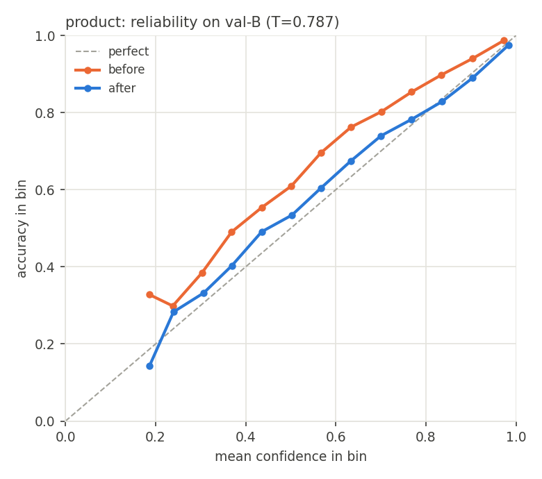
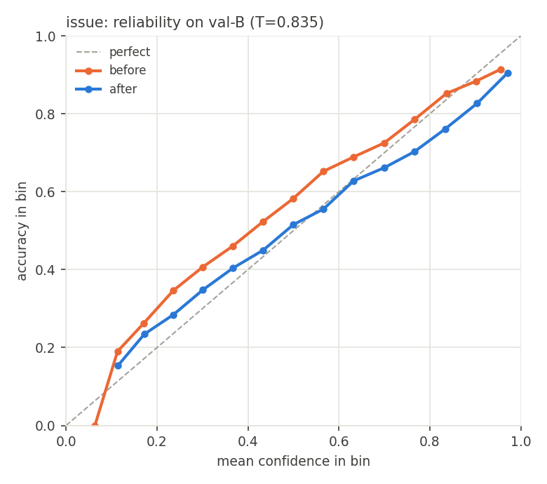
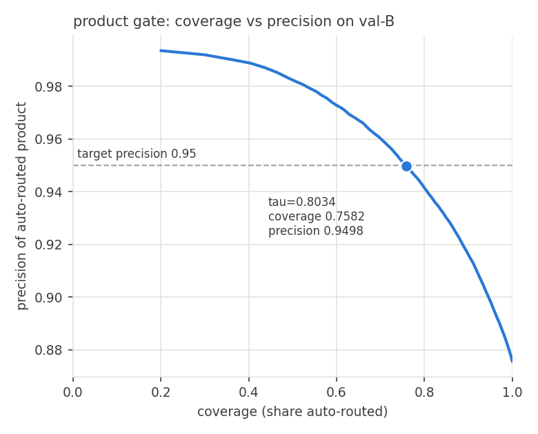

# M4 calibration, confidence gate and priority threshold

Generated by `python -m complaintiq.models.calibrate run` (`make calibrate`). The test split was not read.

- Model: `baseline/tfidf_sgd_alpha2e-6_conv` (model_version `baseline-tfidf_sgd_alpha2e-6_conv-80a3ba969565`, data_version `80a3ba969565`).
- val (187,698 rows) is split once into **val-A** (93,848) and **val-B** (93,850), seeded and stratified on issue_class (`configs/eval.yaml: val_split`).
- **Fit on val-A:** temperatures, tau, priority threshold. **Held-out = val-B:** every number in a column or row labelled val-B. val-A numbers are in-sample for the fitted value and are shown only for reference.
- Caveat: val was also used in M3 to choose this model among the variants, so val-B is held out from calibration and threshold choice, not from model selection.
- Experiment log: `reports/experiments/m4/calibration.csv`, run_ids product `ac784965cb74`, issue `fedad2e3c763`, priority `7e5805be5b79`.

## Temperature scaling (product and issue)

Method: `softmax(log p / T)` on the model's probabilities, T minimizing NLL on val-A. ECE uses 15 equal-width bins on the top-1 confidence. The argmax is unchanged, so accuracy and F1 are unchanged.

| task | T (val-A) | accuracy val-B | ECE val-B before | ECE val-B after | NLL val-B before | NLL val-B after | ECE val-A before | ECE val-A after |
|---|---|---|---|---|---|---|---|---|
| product | 0.787 | 0.876 | 0.0540 | 0.0149 | 0.418 | 0.397 | 0.0537 | 0.0148 |
| issue | 0.835 | 0.609 | 0.0690 | 0.0425 | 1.315 | 1.286 | 0.0687 | 0.0418 |

SPEC A5 target: ECE < 0.05 after temperature scaling. val-B: product meets it (0.0149), issue meets it (0.0425).

Reliability diagrams on val-B (before = raw model probabilities, after = temperature):

Product reliability bins on val-B:

| bin_lo | bin_hi | n | conf_before | acc_before | conf_after | acc_after | n_after |
|---|---|---|---|---|---|---|---|
| 0.000 | 0.067 | 0 |  |  |  |  | 0 |
| 0.067 | 0.133 | 0 |  |  |  |  | 0 |
| 0.133 | 0.200 | 61 | 0.187 | 0.328 | 0.186 | 0.143 | 14 |
| 0.200 | 0.267 | 412 | 0.238 | 0.299 | 0.240 | 0.283 | 219 |
| 0.267 | 0.333 | 1,150 | 0.303 | 0.384 | 0.307 | 0.332 | 578 |
| 0.333 | 0.400 | 1,898 | 0.369 | 0.491 | 0.369 | 0.403 | 1,122 |
| 0.400 | 0.467 | 2,665 | 0.436 | 0.554 | 0.436 | 0.491 | 1,717 |
| 0.467 | 0.533 | 4,112 | 0.501 | 0.609 | 0.503 | 0.534 | 2,865 |
| 0.533 | 0.600 | 4,540 | 0.567 | 0.696 | 0.567 | 0.604 | 3,297 |
| 0.600 | 0.667 | 4,985 | 0.634 | 0.762 | 0.634 | 0.675 | 3,566 |
| 0.667 | 0.733 | 5,730 | 0.701 | 0.802 | 0.700 | 0.740 | 4,087 |
| 0.733 | 0.800 | 6,675 | 0.768 | 0.853 | 0.768 | 0.782 | 4,949 |
| 0.800 | 0.867 | 8,412 | 0.835 | 0.898 | 0.836 | 0.828 | 6,504 |
| 0.867 | 0.933 | 13,509 | 0.904 | 0.940 | 0.903 | 0.889 | 10,344 |
| 0.933 | 1.000 | 39,701 | 0.973 | 0.987 | 0.983 | 0.975 | 54,588 |

## Confidence gate tau (product)

Auto-route precision = product accuracy among complaints with calibrated product confidence >= tau (routing is decided by product, SPEC B6).

tau = **0.8034**: the smallest threshold with val-A precision >= 0.95 (at least 200 rows).

| split | role | coverage | n auto-routed | precision |
|---|---|---|---|---|
| val-A | chosen here | 0.7578 | 71,120 | 0.9500 |
| val-B | **held-out** | **0.7582** | 71,155 | **0.9498** |

SPEC A5 target: auto-route coverage >= 0.60 at >= 0.95 precision. On val-B, coverage 0.7582 meets the 0.60 target; precision 0.9498 misses the 0.95 target (difference -0.0002). A threshold chosen to hit 0.95 exactly on val-A lands on either side of it on held-out data.

Temperature scaling is monotone, so the same rows are auto-routed as with an uncalibrated threshold at the matching raw confidence; calibration changes the meaning of tau (a probability), not the ranking.

Coverage-precision curve on val-B (held-out):

| threshold | coverage | n_auto | precision |
|---|---|---|---|
| 0.3000 | 0.9954 | 93,417 | 0.8784 |
| 0.3500 | 0.9888 | 92,796 | 0.8820 |
| 0.4000 | 0.9794 | 91,917 | 0.8864 |
| 0.4500 | 0.9667 | 90,726 | 0.8916 |
| 0.5000 | 0.9477 | 88,944 | 0.8994 |
| 0.5500 | 0.9219 | 86,525 | 0.9088 |
| 0.6000 | 0.8955 | 84,038 | 0.9176 |
| 0.6500 | 0.8671 | 81,374 | 0.9258 |
| 0.7000 | 0.8356 | 78,423 | 0.9335 |
| 0.7500 | 0.8016 | 75,232 | 0.9410 |
| 0.8000 | 0.7612 | 71,436 | 0.9493 |
| 0.8034 | 0.7582 | 71,155 | 0.9498 |
| 0.8500 | 0.7119 | 66,815 | 0.9583 |
| 0.9000 | 0.6449 | 60,526 | 0.9677 |
| 0.9500 | 0.5390 | 50,587 | 0.9793 |
| 0.9900 | 0.2996 | 28,118 | 0.9920 |

## Priority threshold

Chosen on val-A: the highest threshold on P(HIGH) with HIGH recall >= 0.85 (SPEC A5: recall >= 0.85 at acceptable precision). Threshold **0.3841**. val-B HIGH base rate 0.0865, val-B PR-AUC **0.4599**.

| threshold | how chosen | split | precision | recall | F1 | flagged share |
|---|---|---|---|---|---|---|
| 0.3841 | recall >= target on val-A | val-A | 0.2693 | 0.8501 | 0.4090 | 0.2710 |
| 0.3841 | recall >= target on val-A | val-B (held-out) | 0.2720 | 0.8520 | 0.4124 | 0.2709 |
| 0.6393 | max F1 on val-A | val-B (held-out) | 0.3939 | 0.6005 | 0.4757 | 0.1319 |
| 0.5000 | fixed 0.5 (M3 default) | val-B (held-out) | 0.3202 | 0.7555 | 0.4498 | 0.2040 |

Priority is a proxy label (SPEC B5); rules 2 and 3 are company outcomes the narrative cannot fully reveal, so low precision at high recall is expected.

## Values written to configs/thresholds.yaml

| key | value |
|---|---|
| tau | 0.803386 |
| target_precision | 0.950000 |
| temperature_product | 0.787111 |
| temperature_issue | 0.834840 |
| priority_threshold | 0.384091 |
| priority_target_recall | 0.850000 |
